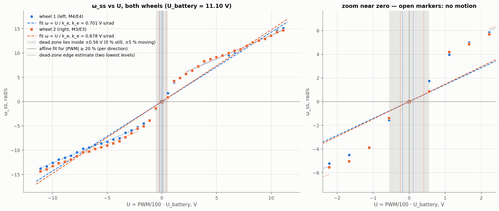
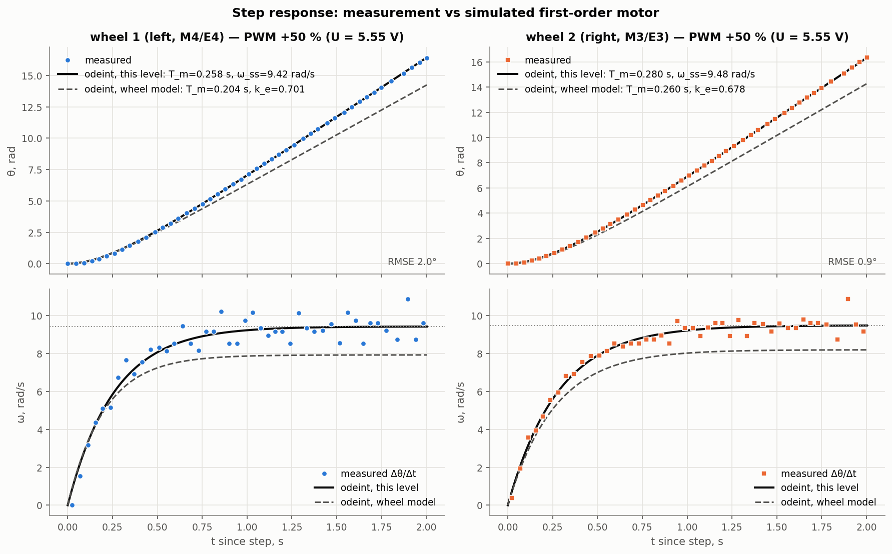

# Lab 5 — Motor parameter identification (TRIK RK370, both drive wheels)

## 1. Experiment

| Item | Value |
|---|---|
| Program | [`motor_identification.qrs`](motor_identification(4).qrs) (TRIK Studio block diagram) |
| Raw data | [`mtr_idf.txt`](mtr_idf.txt), as written by the robot (not edited) |
| Wheels | wheel 1 = left (motor M4, encoder E4, column `whL`); wheel 2 = right (M3, E3, `whR`) |
| PWM levels | −100 % … +100 % in 5 % steps (41 levels, 0 % included); both wheels driven together |
| Step length / rest | 2 s per level, then motors stopped in *float* mode for 1.5 s |
| Sample period | **43 ms median** (target was 5 ms; see §5), ≈ 46 samples per level |
| Battery voltage |11.1 V is assumed for U |
| Load |*The wheels were in the air while testing* |

What the program does (from the `.qrs` diagram):

```
delete mtr_idf.txt → clear encoders E3, E4 → power = −100
while power ≤ 100:
    t0 = time(); t = 0
    while t < 2000 ms:
        θ_L = encoder4; θ_R = encoder3; t = time() − t0     # read first …
        M3 = power; M4 = power                              # … then command
        append "power| whL θ_L | whR θ_R | t" to mtr_idf.txt
        wait 5 ms
    stop M3, M4 (float); wait 1500 ms; power += 5
```

## 2. Method

* Model: `T_m·dω/dt + ω = U/k_e`, `U = PWM/100 · U_battery`. For a step from rest,
  `θ(t) = ω_ss (t − T_m + T_m e^(−t/T_m))`.
* Every level and wheel is fitted with `scipy.optimize.curve_fit` (bounds `T_m ∈ [1 ms, 2 s]`).
  The fitted `T_m`, `k_e = U/ω_ss` are then fed to `scipy.integrate.odeint` to simulate the
  motor next to the measurement.
* `k_e` per wheel is the least-squares fit of `ω_ss = U/k_e` over all moving levels (the
  model from the lecture). Because the data are visibly not proportional, I also fit an
  affine line `ω_ss = a·U + b` per direction for |PWM| ≥ 20 %.
* Dead zone: 0 % gives no motion and ±5 % already turns both wheels, so the dead zone lies
  strictly inside ±5 % PWM (±0.555 V). An estimate of its edges comes from extrapolating
  the two lowest moving levels to ω = 0.

## 3. Results

### 3.1 T_m and ω_ss for every PWM level

Battery voltage used for U: **11.10 V** 

| PWM % | U, V | ω_ss L, rad/s | T_m L, s | RMSE L, ° | ω_ss R, rad/s | T_m R, s | RMSE R, ° | ω_R/ω_L |
|---:|---:|---:|---:|---:|---:|---:|---:|---:|
| -100 | -11.10 | -13.78 ± 0.02 | 0.086* | 3.0 | -14.35 ± 0.01 | 0.064* | 1.1 | 1.041 |
| -95 | -10.54 | -13.30 ± 0.01 | 0.090 | 2.3 | -13.96 ± 0.01 | 0.084* | 0.9 | 1.050 |
| -90 | -9.99 | -12.56 ± 0.01 | 0.106 | 2.1 | -13.29 ± 0.00 | 0.112 | 0.9 | 1.058 |
| -85 | -9.43 | -11.87 ± 0.01 | 0.123 | 2.2 | -12.66 ± 0.00 | 0.141 | 0.7 | 1.067 |
| -80 | -8.88 | -11.56 ± 0.02 | 0.141 | 2.7 | -12.40 ± 0.01 | 0.158 | 0.9 | 1.073 |
| -75 | -8.32 | -11.10 ± 0.01 | 0.116 | 1.4 | -11.94 ± 0.01 | 0.170 | 0.9 | 1.076 |
| -70 | -7.77 | -10.44 ± 0.01 | 0.169 | 1.8 | -11.26 ± 0.01 | 0.203 | 0.7 | 1.078 |
| -65 | -7.21 | -9.69 ± 0.01 | 0.195 | 1.6 | -10.40 ± 0.02 | 0.172 | 3.0 | 1.074 |
| -60 | -6.66 | -9.42 ± 0.01 | 0.199 | 1.5 | -10.29 ± 0.01 | 0.264 | 1.3 | 1.092 |
| -55 | -6.11 | -8.86 ± 0.01 | 0.220 | 1.7 | -9.76 ± 0.00 | 0.274 | 0.6 | 1.101 |
| -50 | -5.55 | -8.60 ± 0.02 | 0.233 | 2.1 | -9.38 ± 0.01 | 0.293 | 0.8 | 1.090 |
| -45 | -5.00 | -8.27 ± 0.01 | 0.214 | 1.1 | -9.05 ± 0.01 | 0.313 | 0.7 | 1.095 |
| -40 | -4.44 | -7.77 ± 0.02 | 0.245 | 2.2 | -8.60 ± 0.01 | 0.316 | 1.1 | 1.107 |
| -35 | -3.88 | -7.52 ± 0.01 | 0.277 | 1.5 | -8.17 ± 0.01 | 0.325 | 0.9 | 1.086 |
| -30 | -3.33 | -6.42 ± 0.02 | 0.300 | 1.7 | -7.34 ± 0.03 | 0.428 | 2.0 | 1.143 |
| -25 | -2.77 | -5.90 ± 0.01 | 0.282 | 0.7 | -6.49 ± 0.01 | 0.371 | 0.9 | 1.101 |
| -20 | -2.22 | -5.23 ± 0.01 | 0.328 | 1.3 | -5.55 ± 0.01 | 0.366 | 0.9 | 1.063 |
| -15 | -1.66 | -4.51 ± 0.01 | 0.349 | 0.9 | -5.06 ± 0.03 | 0.563 | 1.4 | 1.123 |
| -10 | -1.11 | -3.88 ± 0.01 | 0.478 | 0.6 | -3.91 ± 0.01 | 0.461 | 0.8 | 1.006 |
| -5 | -0.56 | -1.56 ± 0.01 | 0.270 | 0.6 | -1.40 ± 0.01 | 0.369 | 0.6 | 0.899 |
| +0 | +0.00 | 0.00 ± — | — | — | 0.00 ± — | — | — | — |
| +5 | +0.56 | 1.75 ± 0.01 | 0.423 | 1.0 | 0.87 ± 0.00 | 0.155 | 0.4 | 0.495 |
| +10 | +1.11 | 3.97 ± 0.01 | 0.341 | 0.7 | 4.19 ± 0.02 | 0.734 | 0.9 | 1.055 |
| +15 | +1.66 | 5.00 ± 0.01 | 0.350 | 0.7 | 4.85 ± 0.02 | 0.461 | 1.3 | 0.970 |
| +20 | +2.22 | 5.84 ± 0.02 | 0.351 | 1.6 | 5.69 ± 0.01 | 0.394 | 0.9 | 0.975 |
| +25 | +2.77 | 6.50 ± 0.01 | 0.328 | 1.4 | 6.37 ± 0.02 | 0.373 | 1.4 | 0.981 |
| +30 | +3.33 | 7.15 ± 0.01 | 0.299 | 1.3 | 7.24 ± 0.01 | 0.399 | 0.6 | 1.012 |
| +35 | +3.88 | 8.13 ± 0.02 | 0.274 | 1.9 | 8.29 ± 0.01 | 0.354 | 1.1 | 1.021 |
| +40 | +4.44 | 8.70 ± 0.03 | 0.285 | 2.7 | 8.70 ± 0.01 | 0.294 | 1.1 | 0.999 |
| +45 | +5.00 | 8.97 ± 0.01 | 0.236 | 1.3 | 9.13 ± 0.01 | 0.279 | 0.9 | 1.018 |
| +50 | +5.55 | 9.42 ± 0.02 | 0.258 | 2.0 | 9.48 ± 0.01 | 0.280 | 0.9 | 1.006 |
| +55 | +6.11 | 9.57 ± 0.02 | 0.229 | 2.3 | 9.93 ± 0.01 | 0.296 | 1.0 | 1.037 |
| +60 | +6.66 | 10.08 ± 0.02 | 0.130 | 2.6 | 10.41 ± 0.01 | 0.243 | 0.8 | 1.033 |
| +65 | +7.21 | 10.43 ± 0.02 | 0.209 | 2.1 | 10.72 ± 0.01 | 0.256 | 0.8 | 1.028 |
| +70 | +7.77 | 11.25 ± 0.02 | 0.180 | 2.6 | 11.47 ± 0.00 | 0.210 | 0.6 | 1.019 |
| +75 | +8.32 | 12.05 ± 0.01 | 0.158 | 2.2 | 12.15 ± 0.01 | 0.181 | 0.9 | 1.009 |
| +80 | +8.88 | 12.50 ± 0.01 | 0.117 | 2.2 | 12.53 ± 0.01 | 0.150 | 0.9 | 1.002 |
| +85 | +9.43 | 12.89 ± 0.01 | 0.122 | 2.3 | 12.88 ± 0.01 | 0.146 | 1.1 | 0.999 |
| +90 | +9.99 | 13.66 ± 0.01 | 0.103 | 2.5 | 13.54 ± 0.01 | 0.110 | 1.1 | 0.992 |
| +95 | +10.54 | 14.59 ± 0.01 | 0.085* | 2.2 | 14.24 ± 0.01 | 0.079* | 1.0 | 0.976 |
| +100 | +11.10 | 15.08 ± 0.02 | 0.074* | 3.7 | 14.65 ± 0.01 | 0.075* | 2.1 | 0.971 |

`*` T_m shorter than two sample periods (~86 ms): poorly resolved. ± is the 1σ standard error from `curve_fit`.

| Parameter | Wheel 1 (left) | Wheel 2 (right) |
|---|---:|---:|
| k_e, V·s/rad (ω_ss = U/k_e, all moving levels) | 0.701 | 0.678 |
| R² of that fit | 0.974 | 0.973 |
| gain, rad/s per % PWM (battery-independent) | 0.1584 | 0.1638 |
| median T_m, s (\|PWM\| ≥ 20 %) | 0.204 | 0.260 |
| incremental k_e forward, V·s/rad (\|PWM\| ≥ 20 %) | 1.018 | 1.045 |
| intercept forward, rad/s | +3.86 | +4.07 |
| incremental k_e reverse, V·s/rad (\|PWM\| ≥ 20 %) | 1.094 | 1.083 |
| intercept reverse, rad/s | -3.46 | -4.14 |
| dead zone, guaranteed bound, V | -0.555 … +0.555 | -0.555 … +0.555 |
| dead zone, estimate from 2 lowest levels, V | -0.183 … +0.118 | -0.245 … +0.410 |

### 3.2 ω_ss against the actual voltage U, both wheels



Filled markers are the fitted `ω_ss`. Dashed lines are `ω = U/k_e`. Thin lines are the
affine fits for |PWM| ≥ 20 %. The grey band is the region that must contain the dead zone.
Dotted verticals are the dead-zone edge estimates. The open marker at U = 0 is the 0 % level
(no motion).

### 3.3 One step response: measurement vs simulated model (PWM +50 %)



The black line is `odeint` with the parameters identified for this level. It sits on the
measurement (RMSE 2.0° left, 0.9° right over ≈ 940° of travel). The dashed line uses one set
of numbers per wheel (`k_e` through the origin, median `T_m`). At +50 % it under-predicts
the speed by ≈ 15 %, and §4 explains why. The lower row compares speeds; the measured
`Δθ/Δt` scatter (±1 rad/s) comes from 1° encoder quantisation over a ~43 ms, jittery sample
period.

### 3.4 Additional figures

| Figure | What it shows |
|---|---|
| [01_step_responses](01_step_responses.png) | all 41 step responses per wheel, coloured by PWM |
| [04_Tm_vs_pwm](04_Tm_vs_pwm.png) | `T_m` against PWM with 1σ error bars |
| [05_fit_grid_wheel_1](05_fit_grid_wheel_1.png), [07_fit_grid_wheel_2](05_fit_grid_wheel_2.png) | every level: measurement vs identified model |
| [06_model_vs_measurement](06_model_vs_measurement.png) | one-number model vs data at ±10, ±30, ±60, ±100 % |
| [07_wheel_mismatch](07_wheel_mismatch.png) | `ω_R/ω_L − 1` against PWM |

## 4. Discussion

The first-order model fits every single step well (RMSE ≤ 3.7°), but its parameters are not constant. `T_m` falls from ≈ 0.35–0.7 s at 5–15 % PWM to ≈ 0.07 s at 100 %, and `ω_ss(U)` is not a line through the origin: it rises steeply between 5 % and 10 % and then follows a line offset by ≈ +4 rad/s. As a result, the one-number model (`k_e` ≈ 0.70 / 0.68 V·s/rad) under-predicts the angle after 2 s by ≈ 50 % at ±10 % and ≈ 25–30 % at ±30 %, and is within 10 % only for |PWM| ≥ 60 % ([fig. 6](06_model_vs_measurement.png)); the dead zone is narrower than our 5 % step, so it is only bounded (|U| < 0.56 V). Forward, the wheels agree within ±4 % from 15 % to 100 % (mean +0.5 %); in reverse, the right wheel is faster at every level from −15 % to −100 % (mean +8.2 %, up to +14 %), and its median `T_m` is longer (0.26 s vs 0.20 s). Encoder odometry next week still measures what the wheels really do, but anything predicted from commanded PWM (simulator, feed-forward, go-to-goal) will drift: equal PWM drives an arc of radius R ≈ b/ε (b = track width, ε = speed mismatch), which is almost straight forward (R ≈ 200 b) but a clear curve in reverse (R ≈ 12 b ≈ 2.5 m for b = 0.2 m), plus a heading kick at every start because of the different `T_m`.

## 5. Data-quality notes and limitations

* **Sample period 43 ms instead of 5 ms.** Each loop iteration writes to the file and runs
  several diagram blocks, which costs ~38 ms. At high PWM, `T_m` is shorter than two sample periods
  (marked `*` in the table), so those values are poorly resolved.
* **Battery voltage not logged.** U uses the nominal 11.1 V. Every `k_e` scales linearly with that
  assumption (`k_e,true = k_e · U_bat,true / 11.1`). The gain in rad/s per % PWM does not depend
  on it. Re-run with `--battery <V>` once the voltage is known.
* **Encoder reset once.** This is handled in the analysis. The raw log is kept unchanged.
* **Single run per level, in one sweep from −100 % to +100 %.** Battery sag during the sweep is
  confounded with PWM.

